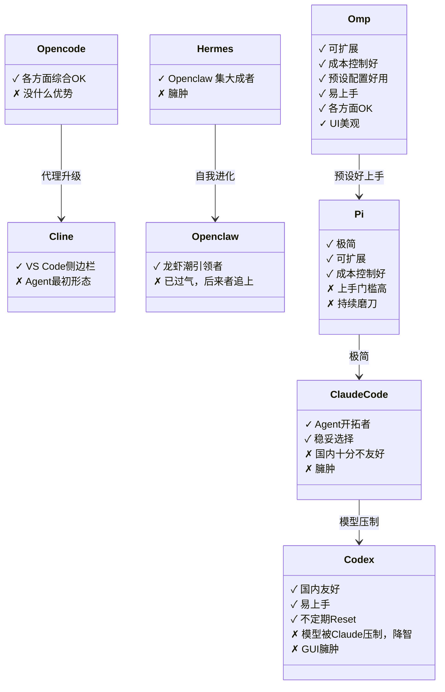

# 🤖 AI Agent 选型

在高强度学习/使用 _AI Agent_ 的一年多里，我试用了市面上主流的大部分 _Harness_。虽然可能也是 _FOMO（Fear of Missing Out）_ 情绪在催动迭代，不过用到后面确实也是用时间实实在在地堆积了一些对 Agent 的使用理解，在这里分享出来。

---
## 目录
- [Agent](#agent)
- [选型](#选型)
  - [使用丝滑](#使用丝滑)
  - [Context 可控](#context-可控)
  - [架构简单](#架构简单)
  - [成本控制](#成本控制)
  - [易上手](#易上手)
- [UI](#ui)
- [总结](#总结)

## Agent

以时间顺序排列的话（从上到下为从早到晚）：
|Agent|性质|
|:-----:|:-----:|
|[Cline](https://github.com/cline/cline)|开源|
|[Opencode](https://github.com/anomalyco/opencode)|开源|
|[Openclaw](https://github.com/openclaw/openclaw)|开源|
|[Hermes](https://github.com/NousResearch/hermes-agent)|开源|
|[Codex](https://github.com/openai/codex)|Openai|
|[Claude Code](https://github.com/anthropics/claude-code)|Anthropic|
|[Pi](https://github.com/earendil-works/pi)|开源|
|[Omp](https://github.com/can1357/oh-my-pi)|开源|

看得出来，很爱折腾了 hhh。

## 选型

除了 FOMO 外，驱动我不断换 Agent 产品的动力其实可以简单分为以下 5 个点。

### **使用丝滑**

在 _Tool Calling_ 和 _Function Calling_ 等基础功能上至少不能阻碍模型本身能力的发挥。这里其实 _Openclaw_ 和 _Hermes_ 的臃肿架构在一定程度上会降低模型表现。

### **Context 可控**

模型的 _Context_（上下文） 长度会影响它的表现，因为每次回传给模型提供商时并非只上传你给出的最新 _Prompt_， 而是把当前窗口所有对话内容全部传给模型提供商，注意力是会被稀释的。研究表明，Context 控制在 **0~20%** 左右是模型表现最好的阶段，再往后模型表现的下降就会比较多了，这并非随 Context 变长而线性下跌，是一个加速下跌的过程，所以模型最大上下文也最好选 1M 的模型，一寸长一寸强。

于是上下文可以自己控制是很重要的，不然一进对话光提前注入的工具占用就到 12% 了还怎么玩，这里 Claude Code 的上下文就有很多无法自己控制，也是我离开的主要原因。

### **架构简单**

一个 _Harness_ 需要能控制住模型不要让它像无头苍蝇一样这改一下那改一下完事还不记得自己当时为什么改以及改了什么，这些其实当下的 Agent 都已经做得很好了，但跟做一个产品一样，做加法很轻松，但判断出哪些功能/限制/设置是没有必要的从而做出减法是很难的。大部分 _Harness_ 在设计之初是为了约束当时还没有那么聪明的模型，但在当下这几个月甚至几周就能快速迭代出一个高表现模型的阶段，这些束缚反而会反过来降低模型的表现。在这里，极简架构的 Pi 是做得最好的，且 Pi 还有一个很好的理念就是：只给所有用户都需要的最基础功能，还需要什么的话用户可以用官方 SOP 手把手让 Agent 自己做一个 _extension_ 出来，把对功能的选择权还给用户，而不是像 Claude Code 一样不断地适配大众用户的需求，越来越臃肿，大部分功能很多用户根本都不会用。

### **成本控制**

与上面所说的 _Harness_ 架构息息相关，一个 _Harness_ 不仅要帮我把活干好还需要照顾好我的钱包，毕竟大多数人都是自费订阅的，_Cache Hit Rate_（缓存命中率） 决定了是否能有效降低成本。

在这里简单科普一下 _Cache Hit Rate_ 是什么以及为什么这么重要，前面我们说过：

> 每次回传给模型提供商时并非只上传你给出的最新 _Prompt_， 而是把当前窗口所有对话内容全部传给模型提供商，注意力是会被稀释的。

这说明我们每次与模型对话都会传很多内容给模型提供商，而他们要在短时间内处理这么多 Token 对算力是个不小的考验。那么怎么缓解这个问题呢 ──*Cache*（缓存），就像看小说/视频一样，在你使用的时候先提前存下一部分内容，这样你再来的时候可以更快地输出。Cache 就是把你最近的 _Context_ 存在模型提供商的服务器上，这样当你再次跟模型对话时，就不用每次都重新分析一遍整个上下文了，模型提供商的压力小了，用户得到反馈也更快了，Win-Win。这也是为什么模型提供商的价格分为命中缓存/未命中缓存两种。当然缓存也不是永久的，经过一段时间后你的缓存会消失，所以不存在第一天晚上没做完不关窗口第二天再来可以降低成本的说法。

从模型产出以及成本来看，Pi 可以在极低成本下达到其他 Harness 相近甚至更好的效果，[Databricks 的实验](https://www.databricks.com/blog/benchmarking-coding-agents-databricks-multi-million-line-codebase):

这里值得一提的除了**金钱成本**外，还有**时间成本**。Pi 可以达到这种低成本的效果一部分是因为它的 Cache Hit Rate 高，还有一部分则是因为它返工少/任务时间短，同一模型的价格一样，如果花的总任务时长短，往往也说明使用了更少的 Token 完成任务，自然更便宜，你自己的时间花费少也是一种隐性收益。

### 易上手

相信大家也看出来了，我是 Pi 的忠实拥护者，毕竟谁不喜欢一个干活高效靠谱还很便宜的助手呢？但 Pi 成也极简败也极简，很多比较常用的功能它都没有，比如 Subagent 和 MCP（Pi 2.0 似乎已经有了）。除此之外还有很多我个人习惯的使用模式都需要在上面一个一个写 extension（扩展）才能迁移过来，其实有 Agent 还好，而且我也是个爱折腾的人。

这时候我看到了 Omp，一套基于 Pi 的预设好的直接就能用的配置，仔细查看 _README_ 后发现“对，that's it！”，省去把大量时间放在磨刀上面，而是直接开箱即用+好用，这无疑是个更好的选择，而且 Omp 支持用 Cladue 订阅驱动，更好了。

- Todo
- Advisor
- Subagent
- Multi-Provider
  还有很多以前没接触过的好功能...

最后，我决定沉下心来深度使用 Omp，发现这确实是针对于我目前来讲的最佳实践了。

## UI

除了以上几点之外，我个人对于 Agent 的 UI 其实也是有一定要求的，好用是前提，好看也是必要条件之一。我很喜欢 _TUI_，在我[个人博客终端的配置](https://blog.asaki.qzz.io/posts/overview/)中也能看出来，使用以上 Agent 几乎都是在终端中使用的（Codex 除外，它前期的 GUI 确实好用，只是后来变得越来越臃肿），因为我觉得 _GUI_ 虽然各种渲染做得很好，但看起来太乱了，什么都往上面塞。针对用户体验的优先级我会更喜欢 _TUI_，毕竟对话才是 Agent 使用最主要的场景，后面我也会针对终端选型出一篇文章。

话说回来， Omp 的 TUI 做得很好，把工具调用和输出包装成一个又一个块很直观，还有很多其他小细节的适配，作者审美在线，看得很舒服。在此基础上，Omp 的作者出了一款终端 ──[Tern](https://blog.asaki.qzz.io/posts/overview/)，它让我在终端配置不变的前提下无缝体验到了 GUI Agent 的便利，比如 Agent 可以直接画个 Svg 出来作为 icon 示意图、后台进程可以实时渲染进度条以及 Subagent 和模型切换通过简单点击即可，且内置终端浏览器、多项自定义设置、 Remote Host，甚至还有 Todo、Canvas、Note 和 SQL 等等。断绝了我中间折腾心起，想回去体验一下 Pi 2.0 的心，搭配起来真的太舒服了，真的就是干活省心便宜，对眼睛也很好，让我持续爱上跟 Agent 对话的体验。

（需要注意，Tern 只对自家 Omp 有渲染，以及目前还在内测阶段，想体验的话需要先进 Waitlist）

## 总结

总而言之，我现在最推荐的 AI Agent 组合是 [Omp](https://github.com/can1357/oh-my-pi) + [Tern](https://blog.asaki.qzz.io/posts/overview/)。

有机会的话一定要去试一下。