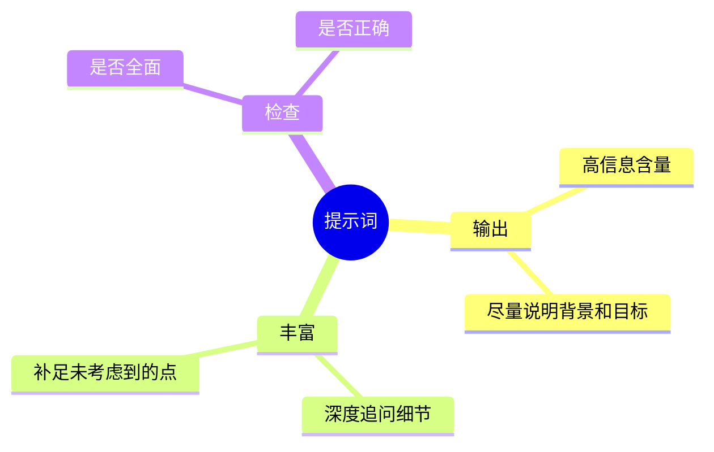

# 如何与 AI 沟通才最高效？

我从 25 年就开始高强度使用 AI，每天都跟 AI 聊天。
渐渐地我发现跟它说话也是有一定窍门的，如果能够熟练掌握并加以应用可以事半功倍。

---

## 你知道你的真实需求吗

现在 AI 发展得越来越迅速，model 的智能程度和能力边界使我们不再需要把提示词写得那么详细它就能懂我们想干嘛并实现出来，似乎 Prompt Engineering（提示词工程）不再像以前那么重要了。

我们作为输入端如果能够把自己真正想要什么用自然语言描述清楚，理论上可以完成很多自己以前完成不了的事情。这里面有个核心问题，那就是**你真的知道自己想要什么吗？**

这听起来很简单，我还能不知道自己想要什么？但其实把自己的真实需求用自然语言描述清楚并没有我们想象中那么简单，需要你预先想清楚：

- 该不该做？
- 怎么做？
- 做成什么样子？

很多人包括我自己之前会忽略这些，把 AI 当许愿机去不断抽盲盒，实打实地对 AI 交付的产出造成了负面影响。我认为整个与 AI 交互的过程与一个需求其实并无二致：

开发和交付由 AI 一手操办，现在的 model 已值得信赖，如 Claude-Opus-5.5、Gemini-Neon-4 和 Gpt-Sol/Astra-6.2 等已经有很强的 Agent 能力可以胜任这两步了，那么还老是出现对成果不满意导致返工的原因我认为其实大部分是来源于需求端和验收端，也就是人这一侧。

之前在科学周刊上看到过一个理论：在未来的 AI 时代下，软件开发会变得像一个哑铃一样，两头重中间轻。开发已由 AI 接管，那么需求和验收阶段就变得尤为重要，甚至验收也变得没那么重要，因为 AI 写代码的速度远远快于程序员 Review 的速度，更多是靠脚本和规则去规范 AI 怎么写代码。于是需求就变成了最重要的部分，所以怎么提需求是值得我们花时间去好好思考的问题。

## 如何提出好的需求？

既然需求这么重要，那么我们该如何提出自己的需求才能高效地让 AI 完全理解并去执行呢？我认为可以分成下面 3 步：

### 第一步：全盘托出

信息含量得给够。

模型做什么、怎么做以及做成什么样子全都靠我们给的那几句话，第一步我一般会先通过语音转文字把自己脑子里面想说的全部说一遍再以文字形式输入给 AI。不用担心思路混乱有一句没一句的，AI 有一个好处就是它可以自动帮我们把刚刚说的一堆话整理成清晰的结构，所以我们要做的事就是畅所欲言，保证尽量全面。

这里有个重点，是我在 [@TW93 的博客](https://tw93.fun/2026-10-29/practice.html) 中看到的：说自己的需求时尽量要带上动机，也就是——为什么？当 AI 知道你为什么而做这个需求时，了解这个功能是解决为了什么问题时，它才不会在一个过于广泛的范围中去给你做东西，而是在你规定的范围中，你的掌控感会更高，原文：

> 多给你的 Agent 讲做这件事情的背景和目标，少替它考虑技术细节，告诉它为什么要做，是给谁用的，做成什么样子你认为是最好的，具体的技术细节让它自己去判断，学会放手。

### 第二步：逐步追问

OK，现在我们的需求已经提出来了，下一步是让它变得更深入以及全面，这里我一般会用 [Matt 的 Skills](https://github.com/mattpocock/skills) 中的`Grill-me` ，这也是这个库中最出名的 Skill，确实很好用。

在 AI 接收到第一步中我们给出的大量信息并整理理解后，这个 Skill 负责让 AI：

- 深度追问可能遇到问题的细节
- 补齐之前我们自己可能没想到的方面

经过这一步，AI 才对我们要做什么、怎么做以及做成什么样子具有了一个较为全面的认知。

### 第三步：确认计划

到这里，我们的需求已经说得差不多了，如果没有补充了就该正式进入到开发环节了。不过这里其实还有一个重要的步骤，也是最后一步。

我们确实已经告诉 AI 我们真实的需求是什么了，但还存在两个问题：

- 对于我们的需求，AI 理解了多少？
- 在陈述以及拷问的过程中，AI 有没有理解偏差？

这是需要进行确认的，AI 虽然很聪明，但我们在与它交流的过程中难免会出现信息不对称。在这里确认好可以一定程度上阻止 AI 偏离方向做出我们不喜欢的东西导致返工，防患于未然。

这里可以用[土豆姐（Poteto）的 skill](https://github.com/cursor/plugins/blob/main/pstack/skills/in-your-own-words/SKILL.md)：`in-your-own-words` 就把这一步做得很好，它让 AI 把计划再重新好好说一遍，方便我们检查是否有什么问题并及时纠正+补充。

## 总结

总结起来其实就下面这几点：

并没有那么复杂，也算不上什么提示词工程，只是以一个相对高效相对精准的方式去与 AI 进行协同，节省我们的时间和精力。
希望能帮到你。
