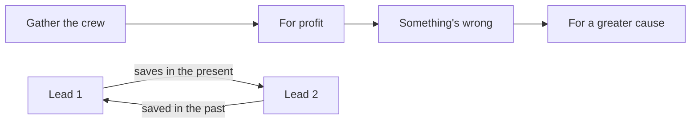

# 观后

Went in with nothing better to do, and it turned out surprisingly good.

---

## The Eight Immortals

The best idea is that the "Eight Immortals" (八仙, *Baxian*) are really the "Pickpocket Immortals" (扒仙, also *Baxian*): **eight ordinary people who scam, cheat, steal and grift for a living** band together to fight the gods. I don't know the myth well, but the twist works surprisingly well.

- **Han Zhongli (Zhongli Quan)**: thief
- **Lü Dongbin (Wu Xin Chang)**: thief / swindler
- **Cao Guojiu**: corrupt official
- **Han Xiangzi**: small-time rogue / inventor
- **Zhang Guolao**: old man who fakes being hit by cars for money
- **Iron-Crutch Li**: arch rogue
- **Lan Caihe**: small-time rogue
- **He Xiangu**: thief

While digging a tunnel from a Taoist temple toward the Three Stars' treasure vault, they run a "god business" as cover, and it actually starts working. They became famous for catching thieves, hence the name "扒仙", from 扒 as in pickpocket. In Zhongli Quan's words: *it takes a thief to know a thief.* It reminds me of a Korean film where a few cops running a long investigation open a fried chicken shop as cover, and the chicken turns out so good the place is packed and they have no time left for the actual job, lol.

## Plot

The plot is rather formulaic. A ragtag crew assembles. They start out chasing worldly power and money, then rally around something nobler, and together the weak beat the strong, mortals against gods. Meanwhile the two leads' story builds through setups and reversals, until the whole backstory is laid out at the end.

Still, this kind of plot is just satisfying, and I can't help it. It works so well for a single-storyline film, and with the classic **mutual redemption** of "you saved me back then, now it's my turn", the combo still hits hard.

The problem is also obvious: **the ensemble isn't an ensemble, and the two leads aren't really two leads.**  
I think the classic structure above is the reason. The film is mostly about the two leads' past and mutual redemption, while some plot and setup for the other six immortals gets mixed in to fit the title. I keep suspecting the fantasy buddy-lead script came first, and the Eight Immortals concept was blended in afterwards.  
I don't think length is the reason the other six lack backstory; going from 2h20min to 3h would have been fine if the story were told well. The point is that adding their stories would dilute the dramatic effect of the two-lead script. Telling eight people's stories in one film isn't impossible, but doing all of them well enough to form an ensemble is very hard, so they played it safe with the two leads.  
That inevitably makes the other six *flat types*. Each has a single reason for joining and no space for background; their traits can only be filled in through speech and body language when everyone is on screen, so it feels like it wouldn't matter much if they weren't there.

Overall I think **the flaws don't outweigh the merits**.  
The two-lead effect works. I half-guessed some of it early on, but the final twist still got me. I'd been wondering why someone who sold out his senior and informed on him didn't look like a righteous man who'd care about saving the world. Sure enough, a leopard doesn't change its spots. I assumed they'd explain his change to make him more three-dimensional, people being multifaceted and all, but he was the final boss all along, and I got fooled by He Xiangu too...

## Clever touches

Apart from the plot controversies, the many small touches show the crew put real effort in.

- **Modernized Penglai**:  
  Clouds are highways, with wrong-way driving and mountain tunnels;  
  mirrors play TV-like programs;  
  banquets require a badge / work pass;  
  Erlang Shen video-calls the Three Stars;  
  Zhang Guolao says if he's faking being hit, he won't get up for less than 100k, "you've found a new dad";  
  the guys dig the tunnel so loudly the Three Stars can't sleep, just like a neighbor's renovation;  
  a leader handling corporate business, even in person, has to make three trips and prove they are themselves.  
  Dropping reality into places it shouldn't belong reminds me of the imagination in Western animated films.
- **Dog bites Lü Dongbin**: One scene shows Lü Dongbin is terrified of dogs, which made me smile. It's explained too: he nearly got bitten as a kid and probably has had a shadow since, which ties into Zhongli Quan having saved him in the past.
- **Let the Bullets Fly homage**: A crowd waiting at the temple gate to make wishes is about to kneel, and Zhongli Quan says "no kneeling, no kneeling". With that camera work I burst out laughing.
- **Every wish granted**: The gods must grant mortals' wishes (please let me into that world). One example was funny and helpless: "He wished for roosters to lay eggs and hens to give milk, saying it'd be good for baking cakes. Isn't that messing with me?" Even Song Dandan can only turn a rooster into an egg-laying rooster, a fighting rooster among roosters, and can't make hens give milk.  
  It reminds me of the bank jokes about elderly customers:  
  "Withdraw all my money. I counted, it's fine, now deposit it back."  
  "I forgot the password. You set it for me, you open it."  
  Infuriating and helpless 😮‍💨
- **Dialects**: The varied dialects sound natural. I wonder whether the crew checked where each immortal is from, or just used dialects for effect.
- **Erlang Shen and Wukong**: The classic Erlang Shen saving his mother, cast as the villain, only he goes too far here; Sun Wukong is the old rival who can start a fight with Erlang Shen anywhere.
- **Classic closed loop**: The protagonist is influenced by someone, becomes a good person who helps others, in turn influences a child, and when the child grows up they meet again, closing the loop.
- **Real-world allusions**: The dark side of Heaven; no need to spell it out.

That's what I remember for now. There's plenty more, and it was fun.

Oh, and the BGM when Lü Dongbin wakes up and stops He Xiangu from killing Zhongli Quan was great. I looked it up: [AJIN MAIN THEME by Yugo Kanno, from Ajin](https://www.youtube.com/watch?v=R-ktUWyTTQY)

## Verdict

Worth watching.
