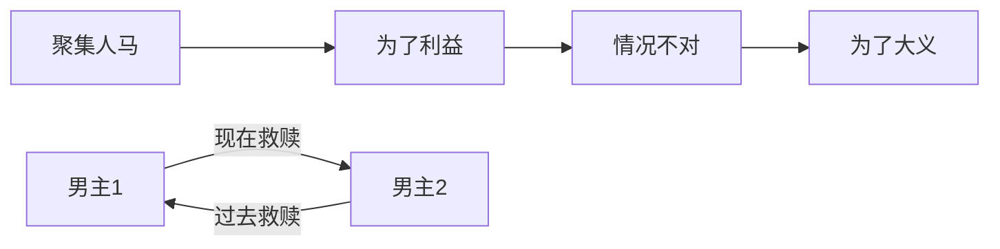

# 观后

  
闲着无聊去看的，意外的好看。

---

## 八仙

最有意思的设定应该是八仙其实是“扒”仙，整体是 **8 个在民间坑蒙拐骗偷贪的凡人**聚集在一起对抗神仙的故事。虽然我对八仙的神话故事没有特别深的印象，不过这种设定还意外地挺有意思。

- **汉钟离（钟离权）**：小偷
- **吕洞宾（无心昌）**：小偷/骗子
- **曹国舅**：贪官
- **韩湘子**：小无赖/发明家
- **张果老**：碰瓷老人
- **铁拐李**：大无赖
- **蓝采和**：小无赖
- **何仙姑**：小偷

在一个道观挖掘通去三星藏宝阁的地道时明面上经营着神仙生意，结果真开起来了。因为主要是抓小偷出名于是取名“扒”仙，取自扒手的 _扒_ ，用钟离权的话来讲就是*贼最了解贼*。有点像我看到的一个韩国电影，里面是几个警察要持续在一个地方调查犯罪分子，为掩人耳目开了一家炸鸡店，结果因为做得太好吃生意爆棚，都没时间去做正事了 hhh。

## 情节

整体情节有些老套：草台班子聚集 ing，一开始是为了一些世俗意义的权/钱，最后向着一个崇高的追求大家众人拾柴火焰高，聚集大家的力量可以小胜大、以弱胜强、以凡人之躯对抗神明，期间两位男主之间的故事随剧情推进而持续铺垫+反转，最后再和盘托出整个故事的来龙去脉。

虽然如此，但这种剧情安排就是看得爽啊，没办法。这样的叙事手法在讲述一个单主线故事时太好用了，再加上经典的“你以前这样救过我，现在该我救你了”的 **双向救赎**，组合拳下来还是很带劲的。

要说问题的话其实也挺明显的：**群像不是群像，双男主不是双男主。**  
我觉得可能也正是因为前面所说的经典情节设计，导致这部电影主要讲的其实是两位男主的前尘往事和双向救赎，但又夹杂着另外 6 仙的一些情节和设定以贴合主题 _八仙_。我老是感觉是不是先有的这个玄幻类双男主剧本然后再加入了八仙的概念糅合成了现在我们所看到的电影。  
在这样的安排下，我觉得制作组也不是因为篇幅原因而没有补足其他 6 仙的背景，从 2h20min 做到 3h 其实问题不大，把故事讲好就行。关键点在于如果加入其他 6 仙的故事会淡化这个双男主剧本的戏剧效果，要用一部电影的时间讲出 8 个人的故事不是做不到，但同时讲好所有人的故事形成群像还是太难了，干脆就做好双男主保底。  
这不可避免地让另外 6 仙的角色形象变得 _脸谱化_ ，加入进来的理由也很单一，没有专门的篇幅去描述他们的背景，他们的设定只能在大家都出镜的时候用一些语言和肢体动作风格来进行补足，也就会让人觉得有他们没他们其实差别不大。

最终呈现出来我认为是 **瑕不掩瑜** 的。  
双男主的效果不错，虽然可能前面隐隐约约猜到了一些，但还是被最后的反转吸引到了。其实我前面就一直在疑惑一个出卖师兄告密的人怎么看都不像是一个会考虑拯救天下苍生的正人君子，果然这原主还是狗改不了吃屎。我想着可能会解释一下这个人物为何转变来把他塑造地更加立体，人的多面性嘛，没想到他才是幕后 Boss，真被何仙姑给骗到了...

## 巧思

除去情节上的一些争议，从制作组的各种小巧思中其实能看出他们是用心了的。

- **现代化蓬莱**：  
  云是高速公路，还存在逆行概念，有穿山隧道；  
  镜子中播放类似于电视的节目；  
  参加宴会要带手牌/工作证；  
  杨戬跟三星打视频电话；  
  张果老说碰瓷就碰瓷，没10w起不来，你找到新爹了；  
  哥几个挖隧道把三星吵得睡不着觉，像极了现实中隔壁装修不得清净；  
  领导去办对公业务，本尊来了也得跑三个来回，还得证明自己是自己才能办理业务。  
  这种把现实巧妙带入不符合它们合理存在的场景中的想象力让我想到欧美动画电影的风格，很像
- **狗咬吕洞宾**：有一幕描述吕洞宾很怕狗，让人看了会心一笑。这里其实也解释了原因，他小时候差点被咬，从小可能就有心理阴影，也与钟离权过去救了他结合起来了
- **让子弹飞致敬**：一堆在道观门口等着许愿的百姓要跪，钟离权说“不准跪不准跪”再加上那个镜头语言我直接笑出声
- **有求必应**：里面的神仙必须要对凡人愿望有求必应（这样的世界请务必让我进去），里面的一个例子我觉得很好笑又很无奈  
  “他许愿让公鸡下蛋，母鸡下奶，说这样好做蛋糕，这不是搞我吗？”宋丹丹来了也只能让公鸡变成下蛋公鸡，公鸡中的战斗鸡，没法让母鸡下奶。  
  莫名想到来银行的大爷大妈段子：  
  “帮我把钱全取出来，我数了没问题，存回去”  
  “密码我忘了，我不知道，当时是你们给我设置的，你们给我打开”  
  让人很火大又无奈 😮‍💨
- **方言口音**：多样化的方言听起来挺自然的，不知道制作组是不是查了八仙分别是哪里人，还是说只是带入一些方言更有效果
- **杨戬悟空**：经典杨戬救母当反派，只不过这个杨戬做得就有点过了；孙悟空老对头了，在哪都能跟杨戬打一架
- **经典传承闭环**：主角受到某个人的影响行侠仗义成为了一个很好的人，进而又影响了某一个小朋友，小朋友长大了他们再次会面，故事闭环
- **现实影射**：天庭暗面，这个就不用明讲了

看完后还记得的暂且是这些，还有不少，挺好玩的。

对了对了，吕洞宾醒过来阻止何仙姑干掉钟离权时的 BGM 很带感，专门去找了,是  
[菅野祐悟给亚人出的 《AJIN MAIN THEME》](https://www.youtube.com/watch?v=R-ktUWyTTQY)

## 总结

值得一看
