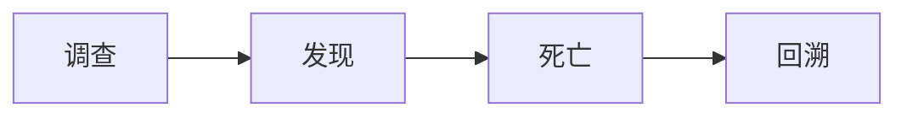

# 观后

近年来看到最令人惊喜的一部动漫。

## 智斗

作为一部智斗番，它没有犯这类动漫最容易犯也最容易让人讨厌的问题 ──**降智操作**。

无论是反派还是正派的行为都没有 _OOC_（Out of Character），所有人都有自己的立场，弃暗投明也都有合理的剧情铺垫与心理转变。主角团/反派都有犯错的时候，但发生的时候不会让人觉得：“哇，这都想不到，也太蠢了吧”这种吐槽，而是“原来如此，这里我也没想到啊”的恍然大悟感，并能很好地带入主角感受到深刻的绝望以及峰回路转的希望。

## 设定

值得一提的是这部番的设定也很有意思，主要是两点：

1. _死亡回溯_。类似于 _《Re0:从零开始的异世界生活》_ 主角 486，这似乎让人觉得重复，但有意思的点在于 ── 反派也拥有与主角一起回溯的能力，这个创新性设定让这部智斗番的可延伸性大大加强，真正地塑造了一种“对弈”感。在此基础上双方都有一个方便传递记忆的设定，在新的世界线上能够快速召集上一轮回的伙伴继续对局。

且这部动漫对*死亡回溯*这个设定的合理化解释其实蛮有意思的，死亡回溯本质上是你是作为一个**观测者**存在的，类似于高维生物“俯瞰+操控”低维空间，就像我们作为三维生物可以随便拿起漫画书进行翻阅一样，里面的人不知道也无法控制，而死亡回溯则是类高维 ── 只能俯瞰不能操控，但作为观测者可以把自己观测到的世界变为现实。之前经历过的回溯是一个个平行世界，回溯后就会消失，但观测者可以把记忆带到下一个世界，这个世界上有两个观测者，一正一邪，也正是它智斗最关键的一环。

2. _影子病_。_一个复制体拥有你的全部，身体、记忆和 DNA_，它的目标是杀死你并取而代之，不然 7 天内它自己会死。这个设定初见是有些吓人的，有一种暴风雪山庄不知道谁是凶手的紧张局促感，但随着主角的调查逐步深入，完整的设定浮出水面就不吓人了，而是更偏向于对抗神话传说中的伪神。

## 情节

整部动漫我相当于是集中在一天看完的，跳过片头片尾换算成时间应该是：
$$20min*25=500min/60=8.33h$$
足以证明其情节之紧凑，本来是打算看两集准备做自己的事情的，没想到根本停不下来。剧情安排没有废话，一直都是在紧张刺激的循环：

紧凑之外又有其合理性，是它最厉害的一点。环环相扣，前面所做的事经历过的情节都会影响后面的发展，其实一定程度上还蛮烧脑的。

最后的升华和伏笔回收可以说是老套但有效，

- 一切的一切都是为了再次见到自己爱的人
- 约定好的事情那就要做到
- 哪怕遭遇到可怕的事情，跟自己喜欢的人站在一起有什么意见吗？？

## 总结

值得一看。
